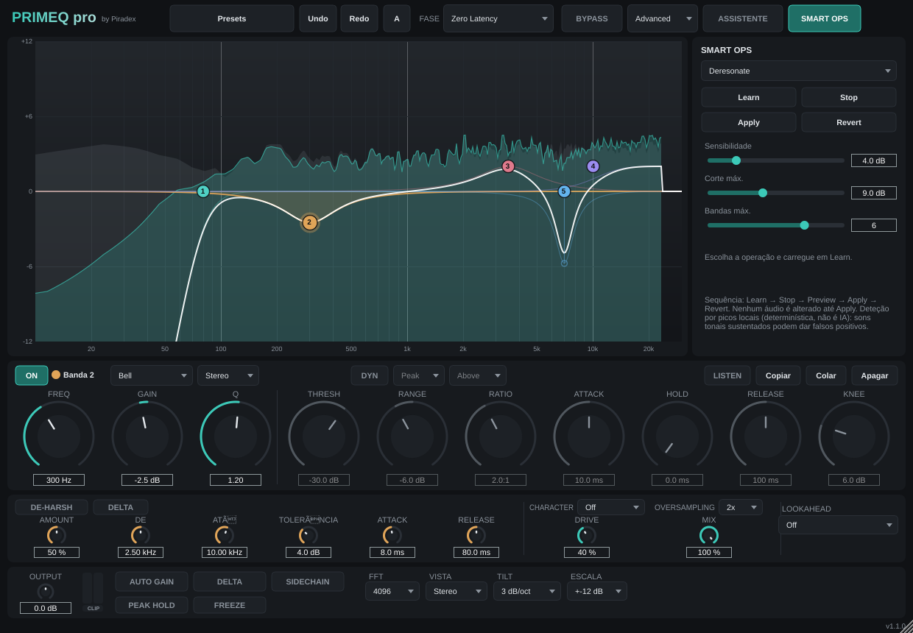
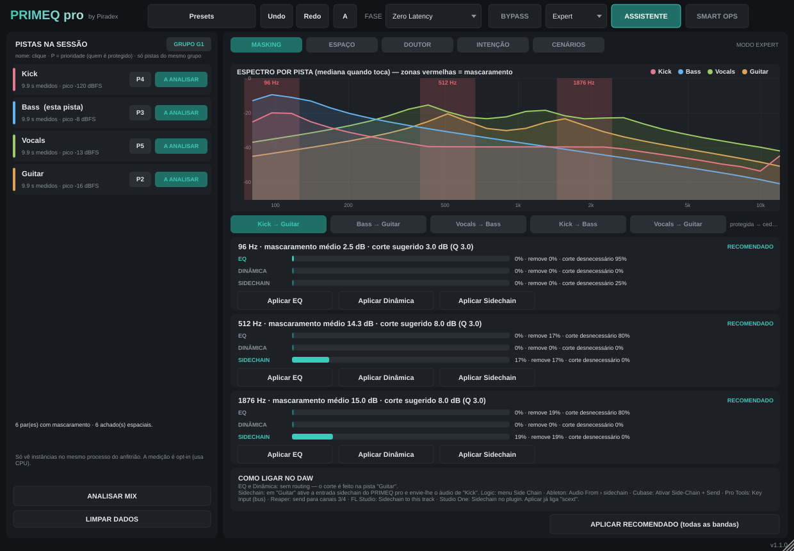
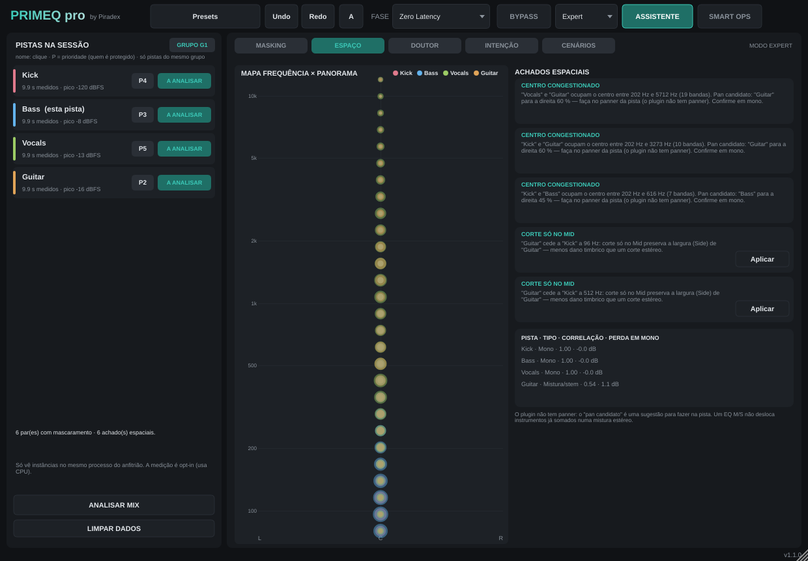
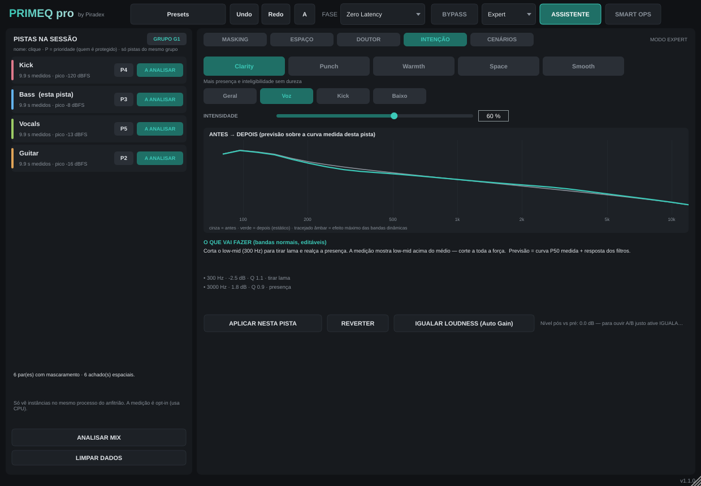

# PrimEQ Pro by Piradex

EQ profissional paramétrico + dinâmico (Beatfreak Music · Plugins by Piradex). C++20 / JUCE 8.






## Características (resumo — ver [Docs/FEATURES.md](Docs/FEATURES.md) para o estado real)
- 24 bandas, 8 tipos de filtro, declives 6–96 dB/oct + Brickwall finito.
- Modos de fase: Zero Latency (IIR), Natural, Linear (FIR com PDC reportada ao anfitrião).
- EQ dinâmico por banda com sidechain externo; analisador FFT real; Smart Ops "Deresonate" (determinístico).
- Licenciamento offline PBKDF2 (master/beta) igual aos outros plugins Piradex.

## Formatos e instaladores
| Plataforma | Saída | Estado |
|---|---|---|
| macOS (universal Intel+Apple Silicon, ≥10.13) | VST3, AU, Standalone, `.pkg` | compilado só no CI; **não testado em DAW real** |
| Windows x64 | VST3, Standalone, `Setup.exe` (Inno Setup) | compilado só no CI; **não testado em DAW real** |
| AAX | — | **não incluído**: exige SDK Avid + assinatura PACE (ver [Docs/AAX.md](Docs/AAX.md)) |

Binários em *Actions → último run → Artifacts* ou em *Releases*. Instalação e resolução de problemas (Catalina): [Docs/INSTALL.md](Docs/INSTALL.md).

## Compilar
```
cmake -B build -DPQ_BUILD_TESTS=ON -DPQ_BUILD_SMOKE=ON
cmake --build build --config Release
```
Documentação: [Arquitectura](Docs/ARCHITECTURE.md) · [Testes](Docs/TESTING.md) · [Licenças](Docs/LICENSES.md) · [Licenciamento/PCC](Docs/LICENSING_PCC.md) · [Assinatura](Packaging/SIGNING.md) · [Changelog](CHANGELOG.md)
